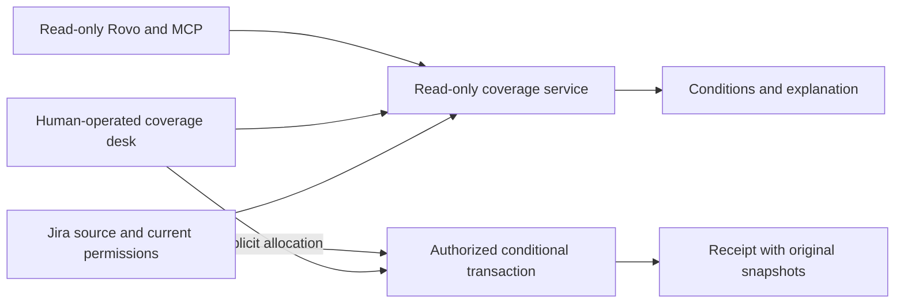

# Waiver Window

**An approval has a boundary. Check whether this job is still inside it.**

Waiver Window is a Forge app for supplier-quality and production coordinators who already work in Jira. A temporary exception can be approved yet still fail to cover a particular part revision, plant, lot, date or quantity. Waiver Window puts those conditions beside the job, then records an explicit allocation against a finite allowance.

The memorable case: an exception allows **500 pieces**. Earlier jobs have **320 allocated**, leaving **180**. Two new jobs ask for **120** and **100**. Each initially fits; their combined 220 does not. The ledger accepts at most one and preserves the reason and receipt. This race passes the local service tests; installed-site concurrency evidence is a separate verification step.

## What is built

- A Jira project page and issue panel with an exact-scope permit, job comparison and finite allocation ruler.
- One approved allowance stream per Jira source within an installation; alternative drafts cannot duplicate it.
- Draft, human approval, revocation and explicit renewal after a changed source. Approval belongs to a Jira project administrator.
- Deterministic coverage checks with expected values, actual values and reasons. Missing evidence does not become a positive result.
- Conditional allocation transactions, safe duplicate retries, single active allocation per canonical job, and cancellation that restores allowance once.
- Historical receipts retaining the original job, scope, source fingerprint and approval provenance.
- Three read-only Rovo/MCP actions: check coverage, read remaining allowance and explain a reservation. They cannot approve or allocate.
- Complete light/dark themes, mobile layouts, keyboard operation and a visibly separate local demonstration.

This is app-owned allowance bookkeeping and a review aid. It does not control physical inventory, release shipments, certify product safety or replace a quality-management system.

## Verified in Jira

Installed production verification passed through the normal Jira interface: approve the existing 500-piece draft, allocate 320 pieces leaving 180, allocate a second 120 leaving 60, block a 100-piece request that exceeds that balance by 40, cancel the 120-piece allocation and restore 180 remaining, then reject an 80-piece job for Chennai when Pune is required even though its quantity fits. These are sequential actions, not a live concurrency test.

Three read-only Rovo/MCP tools are implemented. External MCP execution remains unverified: authorization reached the consent screen, but returned an error before the callback. The cause has not been established. The installed Jira workflow is verified separately. The current entry does not claim the MCP bonus. Live source-change renewal, revocation, restricted-user checks and concurrent requests remain unverified; their local tests are recorded separately in [TESTING.md](docs/TESTING.md).

## Start locally

Use a supported Node runtime from `package.json`, then:

```sh
npm ci --ignore-scripts
npm --prefix static/app ci --ignore-scripts
npm test
npm --prefix static/app run dev
```

Open `http://127.0.0.1:4351/`. This is an explicitly labeled **Local demo** with fictional browser-local records. Its starting allowance is 300 with 120 already allocated; the film and concurrency test use the separate 500/320/180 scenario. Neither local state nor screenshots establish Forge connectivity.

`npm run build` creates the production resource in `static/app/dist`. That build uses the real Forge bridge and fails visibly outside an installed Jira host. It never loads fixtures as a fallback. For registration, deployment, installation and external MCP consent, follow [DEPLOYMENT.md](docs/DEPLOYMENT.md).

## Install for evaluation

[Install Waiver Window for Jira](https://developer.atlassian.com/console/install/90d15fc4-8d94-4ac8-9775-3dcd62b4d6ae?signature=AYABeAtzhE%2FzmYY60ny7bNeXlHIAAAADAAdhd3Mta21zAEthcm46YXdzOmttczp1cy13ZXN0LTI6NzA5NTg3ODM1MjQzOmtleS83MDVlZDY3MC1mNTdjLTQxYjUtOWY5Yi1lM2YyZGNjMTQ2ZTcAuAECAQB4CxqLTo9l4lqXuFjNim1xJM%2Bp%2F3TVP9xHS2BrU5DRRucBV8VdAUh4Z%2BZaj49WpsqDPwAAAH4wfAYJKoZIhvcNAQcGoG8wbQIBADBoBgkqhkiG9w0BBwEwHgYJYIZIAWUDBAEuMBEEDDFSAksKaWMa5FpBdQIBEIA7MjTNLZ0dOl3UsMN1Gmi4AsTJfTyG%2Bhv528Ib12qxC%2B6qsP7g4nYVW5PoOV1xeggXdT8oTt9cAZ1YsX0AB2F3cy1rbXMAS2Fybjphd3M6a21zOmV1LXdlc3QtMTo3MDk1ODc4MzUyNDM6a2V5LzQ2MzBjZTZiLTAwYzMtNGRlMi04NzdiLTYyN2UyMDYwZTVjYwC4AQICAHi9bVMAkme4qVQX1fQHo6ePw3H40A7cGfz7yrmSfBWMXgEfpTACAZDyXrmiC0vwkmy%2FAAAAfjB8BgkqhkiG9w0BBwagbzBtAgEAMGgGCSqGSIb3DQEHATAeBglghkgBZQMEAS4wEQQMHANLEB9NHwfm%2F7jTAgEQgDuSDImoAsW1jIFEGjHdWrS4Ttm94VZFR3ppfJci3mAK0Tcyf4GAq0tjCN1dr%2BlGk3N7Zu9ulkCgFwrStwAHYXdzLWttcwBLYXJuOmF3czprbXM6dXMtZWFzdC0xOjcwOTU4NzgzNTI0MzprZXkvNmMxMjBiYTAtNGNkNS00OTg1LWI4MmUtNDBhMDQ5NTJjYzU3ALgBAgIAeDYASx0XCjkny4iLV6vz%2BKtEGSGT6kdt0QRpkn6D%2FlVEARQqvgJLEKzwThaCXam52okAAAB%2BMHwGCSqGSIb3DQEHBqBvMG0CAQAwaAYJKoZIhvcNAQcBMB4GCWCGSAFlAwQBLjARBAzZEHHoubZCNLXD9pgCARCAO%2FFHB65GbvjWgz8GQPHW%2FndrT5WOQLaRAopTK6OaoXAPlctu9gnUN9x7f4%2F6H9crZz8CfFWUlwq6ODELAgAAAAAMAAAQAAAAAAAAAAAAAAAAAOx1Afrnd68xdB7SouKfrOD%2F%2F%2F%2F%2FAAAAAQAAAAAAAAAAAAAAAQAAADLTf4waqVgPyU9o5atXzynymcSFhieJ9eayer2Q11V5TbF0ZDsa9fcRVaKkDDax4wUga%2Fulorj4z5vgJ6kmSTWjNqk%3D&product=jira). A Jira site administrator must complete installation.

The installer preview has been opened and checked: Waiver Window, Get app, For Jira, read-Jira and app-storage permissions, and the linked vendor policies. A separate judge-site installation and clean-site walkthrough have not yet been verified.

Follow [the setup guide](docs/DEPLOYMENT.md) and [fictional walkthrough](docs/DEMO.md). New installations start empty. **The public demo video and Devpost confirmation remain pending.** See [SUBMISSION.md](docs/SUBMISSION.md) for the current gates.

## How the decision stays grounded



The server reads Jira as the signed-in user. App storage does not automatically inherit issue permissions, so related issues are checked before returning records or performing an action. The actor comes from trusted Forge context. Client-supplied approvers or balances cannot grant authority.

The current allowance is read directly and updated with a conditional Custom Entity transaction. Discovery queries only find records; they never calculate the authoritative balance. Jira source reads and Forge writes are separate operations, so this does not claim a cross-system lock. Source changes are detected conservatively, and receipts can be rechecked against current facts.

## Human authority and agent boundaries

| Action                                 | Required authority                                                  |
| -------------------------------------- | ------------------------------------------------------------------- |
| Inspect records or use read-only tools | Access to the relevant Jira issues and project                      |
| Create/edit an exception               | Edit permission on its source issue                                 |
| Approve, revoke or renew approval      | Jira project-administrator permission                               |
| Create/edit a job; allocate it         | Edit permission on the job issue                                    |
| Cancel an allocation                   | Job edit permission and original allocator or project administrator |

Scope changes are blocked while allocations remain. Once clear, changing scope creates a draft requiring approval; a title-only edit preserves approval. Source renewal requires a changed, available source, an approved and unexpired permit, unchanged scope and zero allocations. Revoked permits remain revoked. There is no automatic quality judgment or model-controlled approval.

The MCP tools also need administrator enablement and client OAuth consent. Copy the full permit ID and selected job ID from **Source & approval provenance**. A remaining quantity by itself is not coverage; use the complete coverage check.

## What makes this focused

Existing quality platforms already handle deviations and concessions. [Quality Events for Jira](https://marketplace.atlassian.com/apps/3669831043/quality-events-for-jira?hosting=cloud&tab=overview) directly serves this domain; [Empower QLM](https://www.empowerqlm.com/your-temporary-deviation-was-approved-whos-tracking-when-it-ends/) discusses temporary-deviation limits. Waiver Window's differentiation hypothesis is a small Jira-native decision surface combining exact per-job coverage, a conditional shared allowance and permission-aware explanations available to agents. Competitor trials and customer interviews are still needed; this is not a world-first claim.

## Guide to the repository

| Location                        | Purpose                                                     |
| ------------------------------- | ----------------------------------------------------------- |
| `src/domain.mjs`                | Validation, canonical fingerprints and exact coverage       |
| `src/ledger.mjs`                | Approval lifecycle, allocation, cancellation and receipts   |
| `src/jira.js`                   | Current-user Jira access and trusted source fingerprint     |
| `src/forge-store.js`            | Conditional storage transactions and bounded discovery      |
| `src/index.js`                  | Forge resolvers and read-only Rovo/MCP handlers             |
| `static/app/`                   | Interface, strict production/demo split and browser checks  |
| `test/`                         | Domain, ledger and mocked platform-adapter tests            |
| `manifest.yml`                  | Forge modules, actions, scopes and storage schema           |
| [DEMO.md](docs/DEMO.md)         | Fictional scenario, judge walkthrough and real capture plan |
| [TESTING.md](docs/TESTING.md)   | What has passed and what remains unverified                 |
| [DESIGN.md](docs/DESIGN.md)     | Product-specific visual and interaction choices             |
| [CONTRACT.md](docs/CONTRACT.md) | API and data contract                                       |

## Current limits and validation

The app has no ERP integration, fulfillment state, automatic source-field extraction, technical-safety assessment or autonomous approvals. Quantities are whole units with exact identifiers. Discovery is bounded to recent accessible records and may lag new writes. A source fingerprint covers issue content and attachment metadata, not attachment bytes. A changed source does not rewrite historical receipts.

No customer study or financial outcome is claimed. The proposed validation is five coordinators comparing their current method with three cases: wrong revision, overlapping allocations and expired approval. Measure correct decisions and time to supporting evidence, then decide whether a pilot is useful. Technical checks are documented separately from customer validation.

## Source, policies and support

[Public source](https://github.com/imshkrsrvstv/waiver-window) · [Setup guide](https://github.com/imshkrsrvstv/waiver-window/blob/main/docs/DEPLOYMENT.md) · [Privacy](https://github.com/imshkrsrvstv/waiver-window/blob/main/PRIVACY.md) · [Evaluation terms](https://github.com/imshkrsrvstv/waiver-window/blob/main/TERMS.md) · [Support](https://github.com/imshkrsrvstv/waiver-window/issues)

The original source is MIT licensed; Atlassian SDK packages retain their own terms. The public source release does not imply a completed Devpost submission, an independent judge-site installation or a finished film. New links are added only after verification.

## License and data handling

Original source is MIT licensed; third-party packages retain their own terms. See [LICENSE](LICENSE), [THIRD_PARTY_NOTICES.txt](THIRD_PARTY_NOTICES.txt), [PRIVACY.md](PRIVACY.md) and [TERMS.md](TERMS.md). This source release includes no dependencies, credentials, installed-site records or generated browser evidence.
